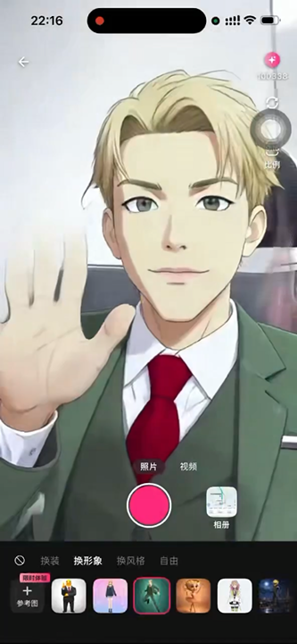
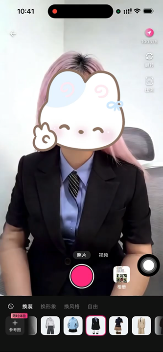
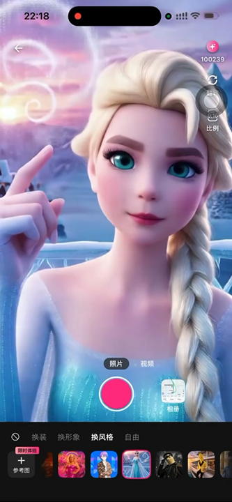
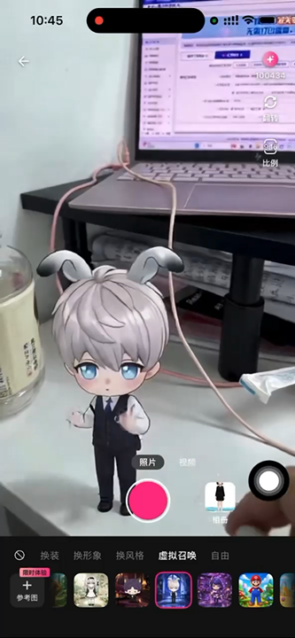

<p align="center">
  
</p>

<p align="center">
  <a href="https://learn.microsoft.com/windows/"></a>
  <a href="https://isocpp.org/"></a>
  <a href="https://dotnet.microsoft.com/"></a>
  <a href="https://platform.xmaxai.com/"></a>
  <a href="./LICENSE"></a>
</p>

We introduce XmaxSDK, a Windows SDK designed for real-time interactive video generation via Xmax models. XmaxSDK implements an end-to-end pipeline covering media acquisition, video streaming, frame-by-frame generation, and on-device rendering, enabling developers to seamlessly integrate low-latency, high-fidelity video transformations into creative applications at a much lower cost than alternative solutions.

<p align="center"></p>

<br>

## What you can build with XmaxSDK

<table>
  <tr>
    <th width="24%" align="left">Realtime Use Case</th>
    <th width="60%" align="left">Description</th>
    <th width="16%" align="center">Demo</th>
  </tr>
  <tr>
    <td rowspan="2" width="24%" valign="middle">
      <strong>Character Swapping</strong>
    </td>
    <td width="60%" valign="middle">
      Replace anyone in your live feed with a designated avatar in real-time.
    </td>
    <td rowspan="2" width="16%" align="center" valign="middle">
      <a href="./Materials/videos/use-cases/character-swapping.mp4">
        
        <br>
        <sub>▶ Play demo</sub>
      </a>
    </td>
  </tr>
  <tr>
    <td width="60%" valign="middle">
      <strong>Prompt:</strong> <code>视频中角色替换成参考图中角色</code>
      <br><br>
      <strong>Reference image:</strong> Select a clear image of the desired character with a clean background.
    </td>
  </tr>
  <tr>
    <td rowspan="2" width="24%" valign="middle">
      <strong>Virtual Try-On</strong>
    </td>
    <td width="60%" valign="middle">
      Seamlessly change outfits, preserving exact body shape, natural motion, and an
      authentic fit.
    </td>
    <td rowspan="2" width="16%" align="center" valign="middle">
      <a href="./Materials/videos/use-cases/virtual-try-on.mp4">
        
        <br>
        <sub>▶ Play demo</sub>
      </a>
    </td>
  </tr>
  <tr>
    <td width="60%" valign="middle">
      <strong>Prompt:</strong> <code>视频中人物衣服替换成参考图中衣服</code>
      <br><br>
      <strong>Reference image:</strong> Select a clear image of the target outfit with a clean background.
    </td>
  </tr>
  <tr>
    <td rowspan="2" width="24%" valign="middle">
      <strong>Video Restyling</strong>
    </td>
    <td width="60%" valign="middle">
      Reimagine your world in any style with an immersive visual experience.
    </td>
    <td rowspan="2" width="16%" align="center" valign="middle">
      <a href="./Materials/videos/use-cases/video-restyling.mp4">
        
        <br>
        <sub>▶ Play demo</sub>
      </a>
    </td>
  </tr>
  <tr>
    <td width="60%" valign="middle">
      <strong>Prompt:</strong> <code>视频风格变为参考图指定的风格</code>
      <br><br>
      <strong>Reference image:</strong> Select an image that captures the artistic style you want to apply.
    </td>
  </tr>
  <tr>
    <td rowspan="2" width="24%" valign="middle">
      <strong>AI Companions</strong>
    </td>
    <td width="60%" valign="middle">
      Summon virtual characters into your live camera feed and interact with them
      through gestures.
    </td>
    <td rowspan="2" width="16%" align="center" valign="middle">
      <a href="./Materials/videos/use-cases/ai-companions.mp4">
        
        <br>
        <sub>▶ Play demo</sub>
      </a>
    </td>
  </tr>
  <tr>
    <td width="60%" valign="middle">
      <strong>Prompt:</strong> <code>指定角色在场景中互动</code>
      <br><br>
      <strong>Reference image:</strong> Select a clear image of the virtual character you want to summon with a clean background.
    </td>
  </tr>
</table>

<br>

## Why XmaxSDK?

<table>
  <thead>
    <tr>
      <th height="104" align="center" valign="middle">
        <br>Low latency
      </th>
      <th height="104" align="center" valign="middle">
        <br>Cost efficiency
      </th>
      <th height="104" align="center" valign="middle">
        <br>High fidelity
      </th>
    </tr>
  </thead>
  <tbody>
    <tr>
      <td>End-to-end latency is measured in , ensuring that updates to generation conditions and interaction controls are reflected instantly.</td>
      <td>Run on a , reducing inference costs by orders of magnitude versus datacenter GPUs like H100.</td>
      <td>Our models support real-time generation at up to , delivering production-ready, high-quality video output.</td>
    </tr>
  </tbody>
</table>

<br>

## Prerequisites

- Windows 10 version 2004 (19041) or later, or Windows 11; x64 applications
- A C++17 compiler, Visual Studio 2022 C++ desktop tools and CMake 3.24 or later for native source builds
- .NET 10 SDK for C# applications; Windows App SDK for WinUI 3 applications
- An Xmax API key

> [!WARNING]
> Never commit your Xmax API key to version control. Pass it securely at
> runtime or use short-lived temporary keys issued by the Xmax API. For step-by-step
> instructions, see [Authentication](https://platform.xmaxai.com/docs/authentication).

<br>

## Installation

### NuGet

Use your local package folder as the NuGet source. For the WinUI quick start:

```powershell
dotnet add package Xmax.SDK.WinUI --source C:/path/to/packages
```

Use `Xmax.SDK.Wpf` for WPF, or `Xmax.SDK` without UI controls. Target x64.

### CMake

Download and extract the SDK from [GitHub Releases](https://github.com/Xmax-AI/XmaxSDK-Windows/releases).
Set `CMAKE_PREFIX_PATH` to the extracted folder, then link your target:

```cmake
find_package(XmaxSDK CONFIG REQUIRED)
target_link_libraries(YourApp PRIVATE Xmax::SDK)
```

<br>

## Quick Start

Use your front camera to turn yourself into a character from a reference image in real time.

```csharp
using Xmax.SDK;
using Xmax.SDK.WinUI;

// Initialize the client
using var client = new XmaxClient(new XmaxConfiguration
{
    ApiKey = "<YOUR_XMAX_API_KEY>",
    Environment = XmaxEnvironment.Global
});

// Initialize the realtime manager
await using var realtime = client.CreateRealtimeManager(new RealtimeConfiguration
{
    Model = RealtimeModel.X2_1
});

// Create the video view
var videoView = new XmaxRealtimeDualVideoView();
videoContainer.Children.Add(videoView);

var previewReady = new TaskCompletionSource(TaskCreationOptions.RunContinuationsAsynchronously);
await realtime.SetStateListenerAsync(state =>
{
    if (state.Reason is RealtimeReason.Failure failure)
        previewReady.TrySetException(failure.Error);
    else if (state.ConnectionState == RealtimeConnectionState.Ready)
        previewReady.TrySetResult();
});

var cameraStream = await realtime.CreateLocalCameraStreamAsync(
    microphone: RealtimeMicrophone.Disabled
);
videoView.LocalTrack = cameraStream.VideoTrack;
await previewReady.Task.WaitAsync(TimeSpan.FromSeconds(15));

var resultStream = await realtime.StartGenerationAsync(
    cameraStream,
    new GenerationContext(
        prompt: "视频中角色替换成参考图中角色",
        referencePath: "https://cdn.xmax.ai/images/playground/charx/charx_image1.png?v=26&presetVersion=20261022"
    )
);
videoView.RemoteTrack = resultStream.VideoTrack;

// Run the following when generation is no longer needed
await realtime.CloseAsync();
```

<br>

## Dependencies

- <ins><strong>Agora RTC SDK</strong></ins> enables low-latency, real-time audio and video communication.
- <ins><strong>Tencent Cloud COS integration</strong></ins> handles media upload and download via object storage, using SDK-managed HTTPS requests and HMAC signing through WinHTTP and BCrypt.

<br>

## Contact us

For bug reports and feature requests, please open a
[GitHub Issue](https://github.com/Xmax-AI/XmaxSDK-Windows/issues). For integration
assistance and technical support, contact us at [sdk@xmax.ai](mailto:sdk@xmax.ai).

<br>

The stream overload of `StartGenerationAsync` opens a connection as needed. The overload that takes only
generation conditions requires an open connection. A failed or cancelled condition update preserves the active
session. SDK result views handle primary pointer gestures using the displayed frame's mirror state. Set
`TrajectoryRenderer` on a WinUI or WPF result view to supply a custom effect while retaining SDK sampling.

## Responsible Use

Use XmaxSDK in compliance with applicable laws and respect the rights of others.
Obtain any required permissions and consents before submitting or using another
person’s likeness, voice, or other protected material. Do not use the SDK to
facilitate fraud, unlawful impersonation, or other illegal activity.

XmaxSDK is licensed under the MIT License. Access to Xmax-hosted services is
governed by the applicable Xmax service terms.

<br>

## License

XmaxSDK is available under the terms of the [MIT License](LICENSE).

## Generated result beauty

`IXmaxRealtimeManaging.SetRemoteVideoBeautyAsync(new RealtimeVideoBeautyOptions(Smoothness: 0.5f, Lightening: 0.3f))`
configures local beauty on generated result pixels. Pass `null` to disable. All four strengths
(`Smoothness`, `Lightening`, `Sharpness`, `Redness`) are finite values in `0..1`, defaulting to zero;
beauty is disabled by default. Configuration survives result replacement and reconnection. `CloseAsync`
disables beauty and clears the beauty error listener.

Register `SetRemoteVideoBeautyErrorListenerAsync(error => ...)` for recoverable frame-processing failures.
The SDK disables beauty and restores original-frame delivery without stopping generation. Initialization
and configuration errors are returned by the configuration method. Managed typed observations use
the UI context captured by `CreateRealtimeManager` or passed to its two-argument overload. Without a
controller context, registration uses the caller's context when available. Headless observations
run on the thread pool. C/C++ callbacks run on a background
worker: dispatch blocking SDK operations elsewhere. Preview and the remote media listener share the same
processed pixels, with timestamps preserved. Camera input, upstream publication, audio and app watermarks
are unchanged. No app-side frame processor is required.

Windows builds with Agora require matching 4.6.2 low-level headers (including `IAgoraService.h`,
`NGIAgora*` and `aosl`) through `-DXMAX_AGORA_LOW_LEVEL_INCLUDE_DIR=<include-directory>`.
The SDK builds and installs `Xmax.VideoBeautyWorker.exe`; distribute it beside `XmaxSDK.dll` with the
matching Agora runtime and ClearVision DLL. Native installation and .NET native payloads include this
helper. It uses a current-user-only pipe/shared memory, bounded waits and a kill-on-close process job.
It creates only a local media graph and never joins RTC or receives account credentials.

The Qt, WPF and WinUI XLab generation toolbars include a **Beauty** toggle without a dropdown arrow or loading suffix. Its four strength sliders appear at the
bottom-right of the result preview. Slider edits are coalesced before calling the SDK; strengths and
the enabled preference are retained across launches. Disabling beauty hides the panel and passes null
to the SDK. A recoverable beauty failure leaves generation running. The UI-only preview does not
modify real preferences or open a camera/cloud session.


## Account credit balance

```csharp
using var client = new XmaxClient(new() { ApiKey = "YOUR_API_KEY" });
XmaxCreditBalance balance = await client.GetCreditBalanceAsync(cancellationToken);
Console.WriteLine(balance.CurrentBalance);
```

The matching C++ method is `client.credit_balance()` and the C entry point is
`xmax_client_get_credit_balance`. They query `GET /balance` with `X-Api-Key` under the client's general
service environment: China uses `https://cloud.xmax.22duck.cn/open/api/v1/balance`; Global uses
`https://api.xmax.cloud/open/api/v1/balance`. The realtime-session endpoint is not used.

Each call reads the current server balance, preserving fractional credits and accepting zero. Missing,
malformed, negative and nonfinite values fail explicitly. Structured API/HTTP errors are retained;
request failure is never converted to a zero balance. Queries create no camera, RTC or generation
session. The caller owns refresh timing and low-credit UI/policy. Cancellation is cooperative through
`CancellationToken`, a C++ predicate, or `xmax_request_cancellation` in C. An active native HTTP phase
may need to finish within its configured timeout before cancellation completes.

## Command delivery and session heartbeats

Generation start, condition changes, and return-size changes carry a frozen `xid`. The SDK sends the
same command through RTC at 0, 300, 1000, 3000, 3300, and 4000 ms until a valid result-user
`xid_ack` arrives. At 6000 ms it stops redundant RTC work and logs a warning. A receipt or the retry
deadline does not finish the original send or confirm generation readiness; startup still waits for
a real result frame. Task replacement, stop, and disconnect cancel obsolete queued controls.

Each logical command also has one independent `POST /client-event/relay` copy using the realtime
service environment and the session's `modelUid`. Missing model identifiers skip HTTP relay while
retaining RTC delivery. Matching receipts with either `accepted: true` or `accepted: false` are valid.
HTTP failure does not retract a successful RTC send, and RTC receipts do not cancel an HTTP copy;
explicit task cleanup cancels both paths. Cancellation of a native HTTP phase may wait for its
configured timeout before cleanup finishes.

RTC room keepalives run while connected. HTTP session heartbeats begin only after `generating` is
committed: the immediate first request includes `firstHeartbeatGraceSeconds`, the connection-start
to generating duration rounded up to whole seconds. Subsequent requests omit the body. Updating
generation does not restart this session heartbeat. Disconnect cancels it and submits server closure
in parallel with local RTC cleanup; delayed heartbeat failures cannot terminate a replacement session.

## Local camera streams

```csharp
var localStream = await realtime.CreateLocalCameraStreamAsync(
    videoFormat: new VideoFormat(1920, 1080, 30),
    camera: RealtimeCamera.SystemDefault,
    microphone: RealtimeMicrophone.SystemDefault,
    mirror: true
);
localView.Track = localStream.VideoTrack;
```

The preset overload accepts `RealtimeCameraPreset`. Enumerate inputs with
`MediaDevices.ListCameraDevicesAsync()` and `MediaDevices.ListMicrophoneDevicesAsync()` before creating
a controller. Use `RealtimeCamera.Device(id)` to select a specific camera. Camera creation requires a
native mode that supports the requested frame rate. Omitted microphone selection disables capture;
`RealtimeMicrophone.Device(id)` selects a Windows recording endpoint. Mirroring applies to local
preview and published camera video together, preserving the independent generated-result display
setting. Creation starts no cloud session and returns after the first camera frame. You can pass
the returned stream to connection or generation immediately. A bound preview can report Ready
before connection starts. The controller owns capture lifetime. Use `StopLocalCameraStreamAsync` after
disconnection, or `CloseAsync`, to release it.
Windows checks microphone privacy and endpoint access when an enabled camera stream is created.
The SDK captures microphone audio through WASAPI on connection and publishes timestamped PCM
through the RTC custom audio track. Microphone level callbacks report the local capture level.
`CreateLocalCameraStreamAsync` replaces camera preparation in ABI v2. Rebuild applications and
deploy the matching managed SDK and native DLL together; ABI v1 binaries are incompatible.

The stream's `VideoTrack` exposes its identity, current format, and camera device. Windows reports
front or back position when it has enclosure metadata for the selected device. Set
`MinimumBitrateKbps`, `MaximumBitrateKbps`, and `EncoderPreference` on `VideoFormat` to configure
uplink encoding when creating or updating a camera stream or binding external video.

Typed state and microphone level listeners replay the current value at registration. Video statistics
listeners receive future snapshots and stream resets. External source properties, start and stop
run on the same UI context when one is available. The remote media frame listener remains a
serialized background callback.

## Media sizing

`CreateMediaService()` returns an `IMediaServicing` instance. Its size resolvers take `MediaSize`
values in pixels. Camera frame rate and encoder settings belong to `VideoFormat` on stream creation
and format updates.

## Media transfers

`CreateStorageManager()` returns an `IXmaxStorageManaging` instance.
`UploadImageAsync`, `UploadImageWithSafetyCheckAsync`, and `UploadVideoAsync` accept a file path or
encoded bytes. `DownloadImageAsync` and `DownloadVideoAsync` return the destination and byte count.
They replace an existing destination only after the transfer succeeds. Pass an
`IProgress<TransferProgress>` to receive byte progress for an individual transfer. C++ exposes
the same operations through `xmax::storage` and accepts per-transfer callbacks.
